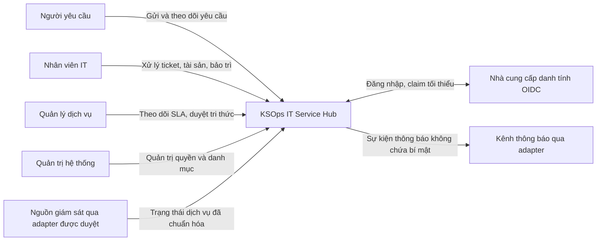
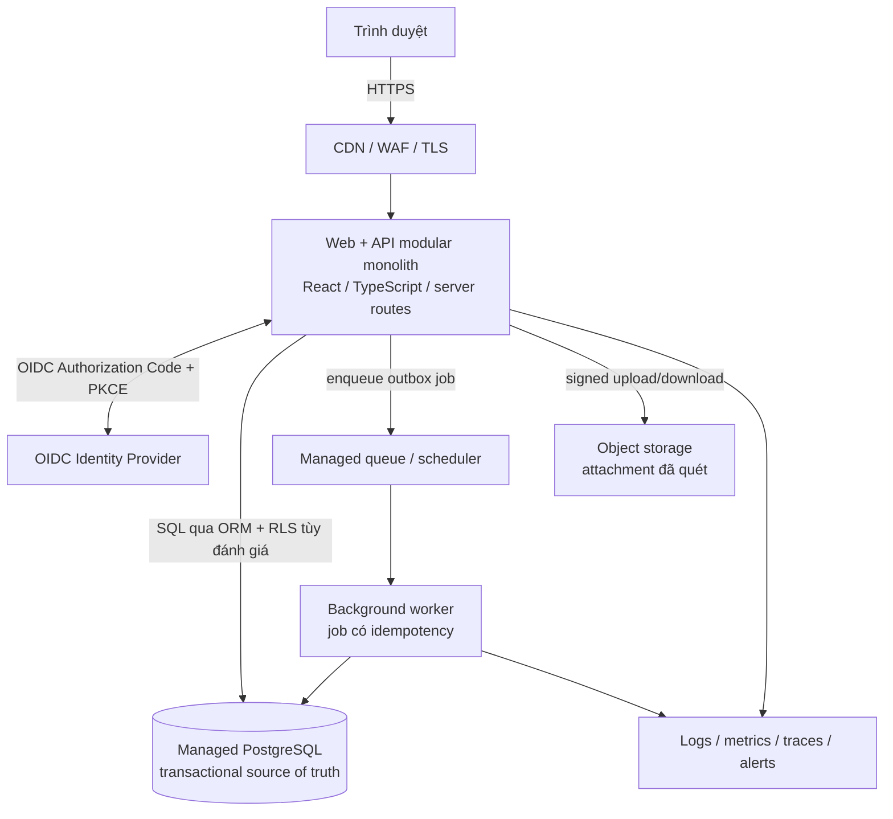
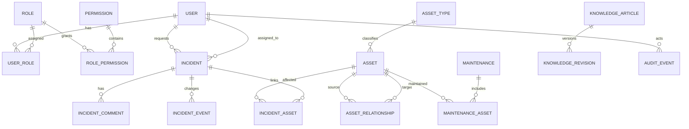
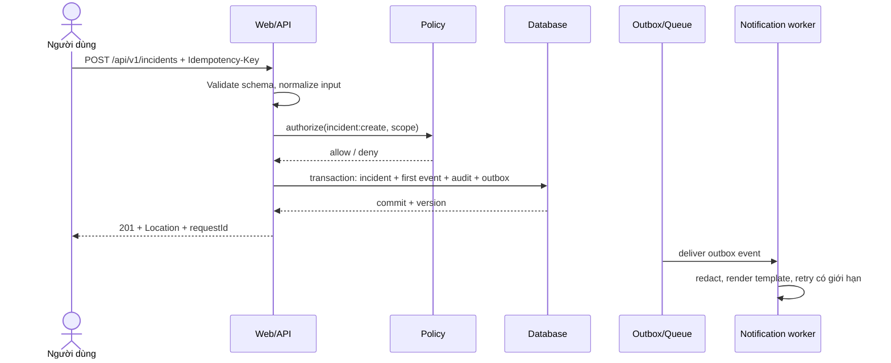

# Kiến trúc KSOps

## 1. Trạng thái tài liệu

- Loại: kiến trúc mục tiêu đề xuất cho pilot, chưa phải mô tả hạ tầng doanh nghiệp.
- Phạm vi: KSOps IT Service Hub/CMDB.
- Dữ liệu trong sơ đồ và ví dụ: hoàn toàn synthetic.
- Nguyên tắc: không đưa IP, hostname, MAC, VLAN, topology, credential hay ảnh nội bộ vào repository.

## 2. Hiện trạng và kiến trúc mục tiêu

Hiện tại repository là một web demo server-rendered bằng Next.js 16 App Router, React 19 và TypeScript. Bảy route sản phẩm đọc dữ liệu synthetic trong source; bộ lọc, xuất CSV, ticket và checklist là tương tác thật ở phía client. Thay đổi do người xem tạo chỉ lưu trong `localStorage`; repository không có database, API nghiệp vụ, SSO hoặc connector tới hệ thống doanh nghiệp.

Mục tiêu pilot là một **modular monolith**: một deployable web/API để giảm chi phí vận hành, nhưng domain được tách module rõ để sau này có thể bóc tách khi có bằng chứng về tải hoặc ownership. Không bắt đầu bằng microservice vì sẽ làm tăng bề mặt bảo mật, distributed transaction và công sức quan sát.

## 3. Bối cảnh hệ thống



Adapter monitoring/notification mặc định là mock ở demo. Tích hợp thật cần data-flow review, tài khoản dịch vụ least privilege, allowlist egress và hợp đồng xử lý dữ liệu.

## 4. Kiến trúc container đề xuất



### Quyết định triển khai

- Web/API chạy cùng region với database để giảm latency và rủi ro data residency.
- Edge chỉ phục vụ asset/cache an toàn; route cần session/transaction chạy trên runtime có kết nối database được hỗ trợ.
- Bản demo dùng Next.js native trên Vercel, đã có build local và route smoke test. Khi bật backend, vẫn phải spike connection pooling, filesystem read-only, function timeout, region và giới hạn gói trước pilot.
- Database không public internet nếu nền tảng hỗ trợ private networking; nếu không, bắt buộc TLS, credential ngắn hạn/rotation và allowlist phù hợp.
- Preview/staging/production dùng project, database và secret tách biệt; không clone dữ liệu production về preview.

## 5. Module và ranh giới trách nhiệm

| Module | Sở hữu | Không được làm |
|---|---|---|
| Identity & Access | user mapping, role, permission, session, policy | tin cậy role gửi từ browser |
| Asset/CMDB | asset, type, status, relationship, history | tự quét mạng hoặc lưu credential thiết bị |
| Service Desk | incident, request, comment, assignment, transition | sửa trực tiếp audit/SLA history |
| Maintenance | schedule, checklist, result, affected CI | thực thi lệnh hạ tầng trực tiếp trong pilot |
| Knowledge | article, revision, review/publish | render HTML không sanitize |
| Service Health | metric snapshot, freshness, adapter | truy cập nguồn monitoring ngoài allowlist |
| Notification | template, preference, delivery job | giữ transaction mở khi gọi dịch vụ ngoài |
| Audit | append-only security/business events | cung cấp endpoint update/delete thông thường |
| Reporting | read model/KPI definitions | truy vấn không giới hạn trên OLTP path |

Module trao đổi qua service interface nội bộ và domain event/outbox. Không import trực tiếp repository của module khác; dữ liệu tham chiếu qua ID và read model đã định nghĩa.

## 6. Cấu trúc mã mục tiêu

```text
app/
  (authenticated)/       # page/layout đã bảo vệ
  api/v1/                # transport: parse, validate, authorize, map response
modules/
  assets/
    domain/              # entity, rule, transition
    application/         # use case, port
    infrastructure/      # Drizzle repository, adapter
  incidents/
  maintenance/
  knowledge/
  identity/
  audit/
lib/
  auth/ validation/ observability/ errors/
db/
  schema/ migrations/ seeds/  # seed chỉ synthetic
tests/
  unit/ integration/ contract/ e2e/
```

Server route chỉ làm nhiệm vụ transport; business rule nằm ở application/domain để unit test được. UI không gọi database trực tiếp và không tự quyết định authorization.

## 7. Mô hình dữ liệu logic



### Quy ước dữ liệu

- Primary key dùng UUIDv7/ULID do server sinh; mã hiển thị (`INC-DEMO-0001`) là key riêng, không chứa thông tin địa điểm.
- Mọi bảng mutable có `created_at`, `updated_at`, `version`; timestamp lưu UTC, hiển thị theo timezone người dùng.
- Soft delete chỉ dùng khi có lý do retention; trạng thái nghiệp vụ `retired/archived` ưu tiên hơn cờ xóa mơ hồ.
- Quan hệ tài sản có `relationship_type`, `source_asset_id`, `target_asset_id`, validity period và unique constraint phù hợp.
- Audit event lưu actor, action, resource type/ID, outcome, request ID, timestamp và diff đã redact; không lưu token hoặc toàn bộ payload.
- Attachment lưu object key và metadata, không lưu binary trong DB. Tên file được normalize; tải xuống qua URL ngắn hạn sau authorization.

## 8. Luồng ghi sự cố



Một transaction ghi entity, history/audit và outbox để tránh tình trạng dữ liệu đã commit nhưng notification event bị mất. Worker xử lý at-least-once; consumer phải idempotent.

## 9. API, consistency và concurrency

- REST JSON version `/api/v1`; contract chi tiết tại `API_SPEC.md`.
- Validation runtime ở boundary; TypeScript type không thay thế input validation.
- `ETag`/`version` + `If-Match` cho update; phiên bản cũ trả `409 CONFLICT` hoặc `412 PRECONDITION_FAILED` theo contract thống nhất.
- `Idempotency-Key` bắt buộc cho create có khả năng retry; key scope theo principal + route và có TTL.
- Cursor pagination cho danh sách lớn; sort mặc định ổn định bằng `(created_at, id)`.
- Transaction chỉ bao quanh thao tác database ngắn; không gọi IdP/email/object storage trong transaction.
- Cache chỉ áp dụng read model không nhạy cảm; key phải bao gồm tenant/scope/role khi cần và invalidation dựa trên event.

## 10. Availability, performance và capacity

Target ban đầu phải được PO/Ops hiệu chỉnh bằng baseline:

| Thuộc tính | Mục tiêu pilot đề xuất |
|---|---|
| Availability web/API | 99,5% theo tháng, loại trừ maintenance đã thông báo |
| API read p95 | < 500 ms ở tải dự kiến |
| API write p95 | < 800 ms ở tải dự kiến |
| Dashboard LCP p75 | < 2,5 s trên profile mạng được thống nhất |
| Error rate | < 1% request hợp lệ trong cửa sổ 5 phút |
| RPO/RTO | RPO 24 giờ, RTO 4 giờ cho pilot; xác nhận bằng restore drill |

Không coi target là cam kết production enterprise. Capacity test dùng dữ liệu synthetic, ramp-up có kiểm soát và không chạy vào endpoint doanh nghiệp thật.

### Cơ chế chống quá tải

- giới hạn body, page size, file size và query complexity;
- rate limit theo principal và IP đã chuẩn hóa, không tin `X-Forwarded-For` ngoài trusted proxy;
- timeout cho DB/external adapter; retry chỉ cho lỗi transient và có exponential backoff + jitter;
- circuit breaker/bulkhead với nguồn monitoring; dashboard hiển thị `stale` thay vì giả vờ dữ liệu mới;
- job queue có dead-letter queue, max attempts và trang replay có phân quyền.

## 11. Observability

Mọi request nhận `request_id` do trusted edge/server sinh; trace context chỉ được chấp nhận sau validation. Log dạng JSON gồm timestamp, level, service, environment, route template, status, latency, request ID và pseudonymous actor ID. Không log authorization header, cookie, token, raw comment, nội dung attachment hoặc chi tiết tài sản nhạy cảm.

Golden signals:

- traffic theo route/status và active session;
- latency p50/p95/p99, DB pool wait, slow query;
- error rate theo error code, auth deny và validation reject;
- saturation CPU/memory/concurrency/queue depth;
- business metrics: incident backlog, SLA breach, stale health source;
- security metrics: login failure burst, permission change, bulk export.

Alert phải có severity, threshold/window, owner, link runbook và cách xác nhận false positive. Không alert trực tiếp từ một sample đơn lẻ trừ sự kiện bảo mật trọng yếu.

## 12. Backup, retention và disaster recovery

- Managed database bật point-in-time recovery nếu gói hỗ trợ; backup được mã hóa và tách quyền restore.
- Restore test vào môi trường cô lập bằng dữ liệu synthetic hoặc đã phê duyệt; ghi thời gian và checksum/evidence.
- Object storage bật versioning/lifecycle; attachment hết retention được xóa theo job có audit.
- Retention từng loại dữ liệu do Data Owner và pháp lý quyết định, không hard-code dựa trên giả định.
- Runbook bao gồm mất database, lỗi migration, lộ credential, queue backlog và lỗi IdP.

## 13. CI/CD và supply chain

```mermaid
flowchart LR
    PR["Pull request"] --> CI["Lint + type/build + tests + audit"]
    CI --> Review["Review + branch protection"]
    Review --> Artifact["Immutable artifact + provenance"]
    Artifact --> Staging["Deploy staging + migration check + smoke"]
    Staging --> Approval["Change approval"]
    Approval --> Prod["Promote same artifact"]
    Prod --> Verify["SLO + smoke + audit verification"]
    Verify -->|"failed"| Rollback["Rollback / forward-fix"]
```



- `npm ci` dựa trên lockfile; pin Node version; Dependabot/Renovate theo chính sách nhóm.
- GitHub Actions dùng least-privilege permissions, môi trường protected và OIDC federation thay cho secret cloud dài hạn khi hỗ trợ.
- Build một lần, promote cùng digest; không rebuild khác nhau giữa staging và production.
- Migration chạy như job riêng có advisory lock và preflight; không tự động destructive migration.
- Tạo SBOM và scan dependency/container ở giai đoạn hardening; critical/high là release blocker trừ waiver có hạn.

## 14. Các ADR cần chốt trước pilot

| ADR | Câu hỏi | Deadline |
|---|---|---|
| ADR-001 | modular monolith và ranh giới module | tuần 2 |
| ADR-002 | hosting/runtime được hỗ trợ chính thức | tuần 2 |
| ADR-003 | PostgreSQL provider, pooling, backup/data residency | tuần 3 |
| ADR-004 | OIDC provider, claim mapping, session model | tuần 3 |
| ADR-005 | permission model và data scope | tuần 3 |
| ADR-006 | attachment storage/scanning/retention | trước tuần 6 |
| ADR-007 | telemetry vendor và redaction policy | trước tuần 8 |
| ADR-008 | deploy/migration/rollback strategy | trước tuần 10 |

## 15. Nguyên tắc tiến hóa

Chỉ tách service khi có ít nhất một tín hiệu: ownership độc lập, tải/availability khác biệt rõ, nhu cầu scale riêng hoặc boundary bảo mật bắt buộc. Khi tách, contract event/API phải versioned, có consumer test, idempotency, trace và kế hoạch migration. Không biến dashboard thành hệ thống điều khiển hạ tầng; mọi automation có tác động cần phê duyệt, dry-run, audit và kill switch.
