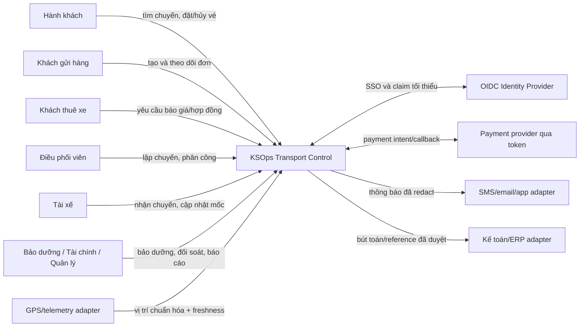
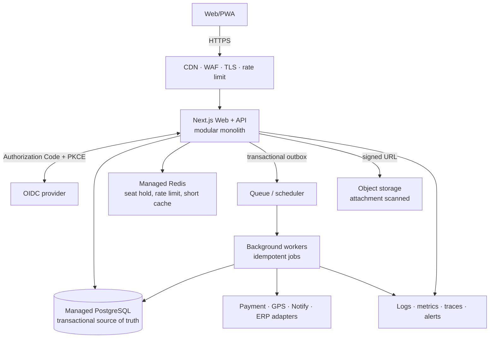
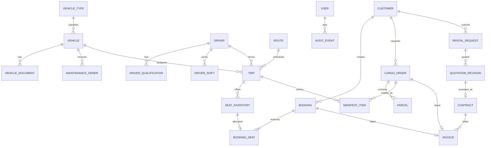
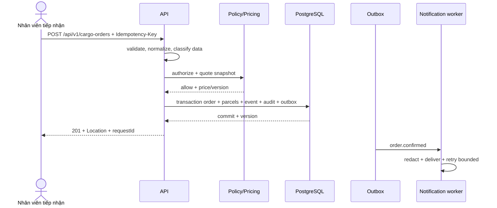
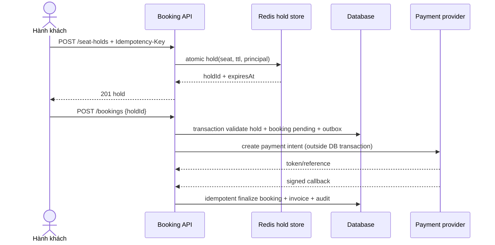

# Kiến trúc KSOps Transport Control

## 1. Trạng thái và nguyên tắc

- Đây là kiến trúc mục tiêu cho pilot, không mô tả hạ tầng doanh nghiệp hiện tại.
- Bản repository là frontend demo Next.js với fixture synthetic và localStorage.
- Không kết nối GPS, bán vé, thanh toán, kế toán, kho hàng hoặc danh tính thật.
- Không đưa biển số, số giấy tờ, vị trí GPS, PII, topology hay credential thật vào mã nguồn.

Kiến trúc mục tiêu là **modular monolith**: một deployable web/API để giảm chi phí vận hành nhưng có ranh giới domain rõ. Chỉ tách service khi có nhu cầu scale, availability, security boundary hoặc ownership độc lập được đo bằng bằng chứng.

## 2. System context



Adapter bên ngoài mặc định là mock. Tích hợp thật cần data-flow review, least-privilege service account, allowlist egress, timeout, circuit breaker, reconciliation và cơ chế thu hồi quyền.

## 3. Container mục tiêu



Web/API chạy gần database; edge chỉ cache asset/read model an toàn. Preview/staging/production dùng project, database, key và adapter sandbox riêng. Không clone production PII về preview.

## 4. Module boundaries

| Module | Sở hữu | Không được làm |
|---|---|---|
| Identity & Access | user mapping, role, permission, scope, session | tin role/tenant gửi từ browser |
| Fleet | vehicle, type, capacity, document, status history | lưu credential thiết bị hoặc GPS thô không cần thiết |
| Driver & Workforce | qualification, availability, shift, assignment constraint | lưu bản chụp giấy tờ ngoài retention/purpose |
| Cargo Order | parcel, sender/receiver ref, pricing snapshot, SLA, status | tự quyết định dispatch hoặc sửa audit history |
| Trip & Dispatch | route, schedule, vehicle/driver assignment, manifest, capacity | bypass maintenance/qualification policy |
| Passenger Booking | inventory, seat hold, booking, cancel/refund state | lưu PAN/CVV hoặc bán ghế ngoài transaction |
| Contract Rental | lead, quote revision, approval, contract | thay giá đã chấp nhận mà không tạo revision |
| Maintenance | trigger, work order, checklist, downtime, part usage | tự xóa lịch sử xe |
| CRM | customer identity tối thiểu, consent/purpose, timeline | cung cấp PII ngoài scope role |
| Billing | invoice snapshot, receivable, payment reference, reconciliation | xử lý dữ liệu thẻ trực tiếp |
| Reporting | metric definition và read model | truy vấn OLTP không giới hạn |
| Notification | template, preference, delivery job | giữ DB transaction khi gọi dịch vụ ngoài |
| Audit | append-only security/business event | endpoint update/delete thông thường |

Module trao đổi qua application service và domain event/outbox; không import repository của module khác. Mọi authorization quyết định ở server/application boundary.

## 5. Cấu trúc mã

Bản demo:

```text
app/
  _components/          # shell và control dùng chung
  _hooks/               # local browser-state adapter
  <feature>/
    page.tsx             # metadata + server composition
    <Feature>Client.tsx  # state/event orchestration khi cần
    _components/         # presentation components
    _lib/                # type, fixture, decoder, pure helper
lib/                     # dashboard aggregate synthetic
tests/                   # helper, config và regression
```

Khi có backend:

```text
app/(authenticated)/
app/api/v1/              # parse → validate → authorize → invoke → map
modules/
  fleet/ driver/ order/ dispatch/ booking/ contract/
  maintenance/ crm/ billing/ reporting/ identity/ audit/
    domain/              # entity, value object, invariant
    application/         # use case, port, policy
    infrastructure/      # repository, outbox, adapter
lib/auth/ validation/ errors/ observability/
db/schema/ migrations/ seeds/
tests/unit/ integration/ contract/ e2e/
```

## 6. Mô hình dữ liệu logic



Quy ước:

- UUIDv7/ULID server-side làm primary key; mã hiển thị là key riêng không chứa PII.
- Timestamp UTC; UI hiển thị timezone người dùng.
- Entity mutable có `version`; update cần optimistic concurrency.
- Tiền lưu integer minor unit + currency; giá/cước/thuế snapshot bất biến.
- PII tách khỏi event/log/read model rộng; field encryption theo threat model.
- Attachment nằm object storage, quét malware, MIME sniffing, signed URL ngắn hạn.
- Audit lưu actor/action/resource/outcome/requestId/time/diff đã redact; không lưu token/raw payload.

## 7. Luồng tạo đơn hàng hóa



## 8. Luồng giữ và bán ghế



Unique constraint trên `(trip_id, seat_code)` cho state booked và transaction/lock phù hợp là lớp cuối chống double-booking; UI disable ghế không phải cơ chế bảo vệ.

## 9. Dispatch consistency

- Assignment kiểm tra overlap xe/tài xế bằng transaction và constraint/exclusion phù hợp.
- `version` + `If-Match` cho thay đổi chuyến; bản cũ trả `412`.
- Capacity tính từ manifest/booking active trong cùng transaction.
- Xe bảo dưỡng/blocked/document-expired hoặc tài xế không qualification bị policy từ chối.
- Manual override yêu cầu permission riêng, reason, expiry và audit; không cho override safety invariant cứng.
- Mốc GPS/scan xử lý at-least-once, có event key idempotent và device timestamp sanity check.

## 10. API và async work

- REST JSON `/api/v1`, cursor pagination, sort ổn định `(created_at,id)`.
- Runtime schema validation; TypeScript không thay thế validation boundary.
- `Idempotency-Key` cho create/payment callback; scope theo principal+route, có TTL.
- Error envelope ổn định, không trả stack/SQL/PII.
- Transaction ngắn; không gọi payment/SMS/GPS/ERP khi đang giữ DB transaction.
- Transactional outbox bảo đảm entity và event cùng commit; consumer idempotent, retry exponential+jitter, DLQ và replay có permission/audit.

## 11. Availability, performance và overload

Mục tiêu pilot: availability 99,5%/tháng; API read p95 <500ms; write p95 <800ms; valid error <1%/5 phút; dashboard LCP p75 <2,5s trên profile thống nhất; RPO 24h/RTO 4h được restore drill xác nhận.

Giới hạn bắt buộc: body/page/file/query complexity; rate limit principal/IP trusted; DB pool/timeout; external adapter timeout+circuit breaker; stale indicator cho GPS; queue max attempts/DLQ; report chạy read model/batch thay vì OLTP path.

## 12. Observability

Log JSON gồm timestamp, level, service/environment, route template, status, latency, requestId, traceId và actor pseudonymous. Không log cookie/token, CCCD/bằng lái, số điện thoại đầy đủ, raw location, comment/attachment hoặc payment payload.

Golden signals và business signals:

- traffic, latency p50/p95/p99, error, saturation, DB pool, queue depth;
- order backlog, delivery SLA, booking conflict, hold expiry, trip delay;
- fleet utilization, maintenance overdue, driver/vehicle conflict;
- payment callback/reconciliation mismatch, export volume, permission change;
- adapter freshness/error và alert có owner+runbook.

## 13. CI/CD và data migration

```mermaid
flowchart LR
    PR["Pull request"] --> CI["type · lint · test · build · audit"]
    CI --> Review["review · branch protection"]
    Review --> Artifact["immutable artifact · SBOM"]
    Artifact --> Staging["staging · migration preflight · smoke"]
    Staging --> Approval["change approval"]
    Approval --> Prod["canary/promote same digest"]
    Prod --> Verify["SLO · business reconciliation · audit"]
    Verify -->|"fail"| Recovery["rollback / forward-fix"]
```



Migration dùng expand→migrate→contract, advisory lock và backup/preflight. Không destructive migration tự động. Build provenance, dependency scan, least-privilege GitHub Actions và OIDC federation khi nền tảng hỗ trợ.

## 14. ADR cần chốt

| ADR | Quyết định | Hạn |
|---|---|---|
| ADR-001 | modular monolith và boundaries | tuần 2 |
| ADR-002 | hosting/runtime/region/data residency | tuần 2 |
| ADR-003 | PostgreSQL, pooling, backup | tuần 3 |
| ADR-004 | OIDC/session/claim mapping | tuần 3 |
| ADR-005 | permission + data scope | tuần 3 |
| ADR-006 | seat hold/booking concurrency | trước tuần 7 |
| ADR-007 | attachment scanning/retention | trước tuần 8 |
| ADR-008 | payment/ERP/GPS adapter contracts | trước tuần 8 |
| ADR-009 | observability/redaction vendor | trước tuần 9 |
| ADR-010 | migration/promotion/rollback | trước tuần 10 |

## 15. Tiến hóa

Chỉ tách service khi có ownership, tải/availability, scaling hoặc security boundary rõ. Khi tách phải version contract, consumer test, idempotency, trace, replay và migration plan. Không biến dashboard thành cơ chế tự động điều khiển xe; automation có tác động cần approval, dry-run, audit và kill switch.
