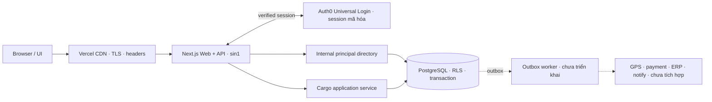
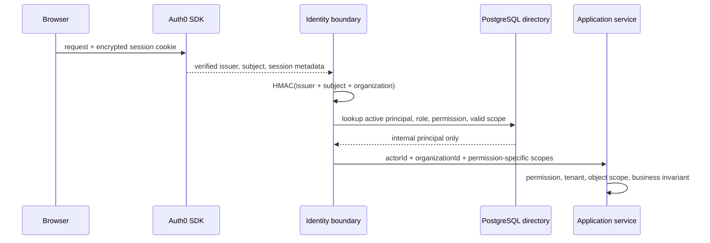
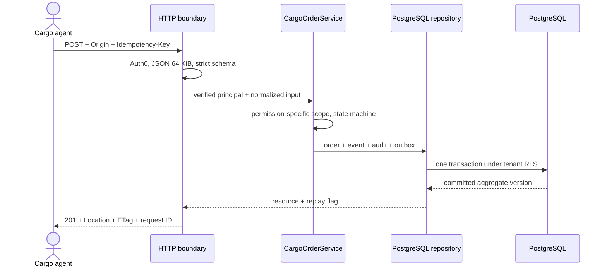
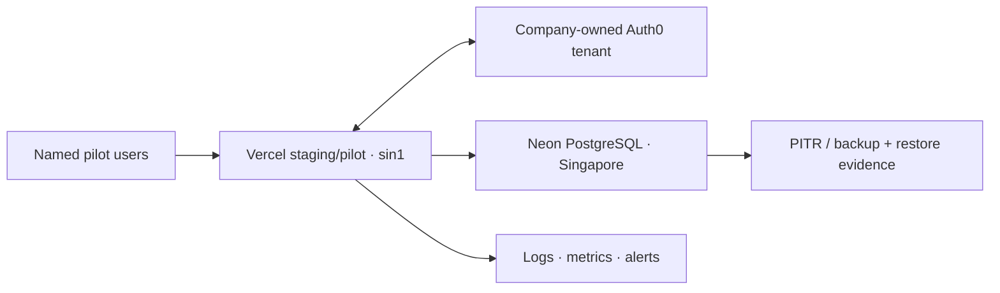

# Kiến trúc KSOps Transport Control

## 1. Trạng thái kiến trúc

KSOps hiện là một **modular monolith đang chuyển từ demo sang pilot foundation**:

- Bản Vercel công khai chạy `demo`: UI synthetic, không dùng Auth0/PostgreSQL cho nghiệp vụ.
- Mã nguồn đã có foundation production-shaped cho Auth0, PostgreSQL và cargo API.
- Cargo là vertical slice đầu tiên có backend và workspace UI nối API theo runtime mode; deployment công khai vẫn chọn demo.
- Dispatch đã có schema và database overlap constraint nhưng chưa có application/API production.
- Booking, contract, maintenance, CRM, finance và reporting vẫn là demo/local.

“Production-shaped” chỉ mô tả cấu trúc và invariant đã triển khai; không có nghĩa đã provision hạ tầng, UAT, security review, backup hoặc support production.

## 2. Hai runtime mode

| Mode | Hành vi |
|---|---|
| `demo` | mặc định; proxy bỏ qua Auth0; UI dùng fixture/`localStorage`; readiness báo không có durable persistence; API nghiệp vụ fail closed |
| `pilot` | yêu cầu đủ cấu hình; Auth0 middleware bảo vệ request; principal được ánh xạ qua PostgreSQL; cargo API dùng repository bền vững |

Mode được xác định server-side. Thiếu cấu hình ở `pilot` trả `PILOT_NOT_CONFIGURED`; không tự dùng mock repository. Endpoint capabilities hiện cố ý giữ các cờ enterprise ở `false` cho đến khi một môi trường được provision và xác minh; không dùng nó để tự động mở traffic pilot.

## 3. Context và trust boundary



Browser không được gửi organization, role hoặc permission có thẩm quyền. Mutation yêu cầu session hợp lệ, same-origin, body bị giới hạn, idempotency key và expected version khi cập nhật.

## 4. Luồng xác thực và phân quyền



Các claim role/permission bên ngoài bị bỏ qua. Chỉ principal `active`, role `active`, grant chưa revoke và còn hiệu lực mới được dùng. Subject Auth0 không được lưu raw trong database; directory tra cứu bằng HMAC có key.

Scope được gắn với từng permission: một role không liên quan có organization scope không được mở rộng cargo permission chỉ có branch scope. RLS được bootstrap trong cùng transaction bằng `app.organization_id` và `app.principal_id`. Đây là lớp tenant isolation bổ sung; authorization theo permission/object scope vẫn nằm tại application service.

## 5. Cargo vertical slice



Create và transition ghi aggregate, immutable business event, audit event, outbox message và idempotency result trong một transaction. Lỗi rollback toàn bộ. Public presenter loại `organizationId` và actor khỏi response.

## 6. Module boundaries hiện tại

```text
app/api/v1/                         # HTTP parse/auth/map; không chứa domain rule
lib/server/config                   # fail-closed runtime configuration
lib/server/auth                     # Auth0 verifier và principal directory
lib/server/db                       # bounded PostgreSQL pool
lib/server/http                     # request ID, Origin, body limit, Problem Details
modules/identity/domain             # permission/tenant/scope guard
modules/cargo/domain                # aggregate invariant và transition matrix
modules/cargo/application           # use cases và transaction ports
modules/cargo/infrastructure        # PostgreSQL/in-memory adapters và container
modules/cargo/presentation          # strict HTTP schema và public presenter
db/schema.ts                        # Drizzle runtime mapping
db/migrations                       # reviewed authoritative SQL
```

Module không được import repository của module khác. Khi mở rộng, giữ cấu trúc `domain/application/infrastructure/presentation`; chỉ tách microservice khi có bằng chứng về scale, availability, security boundary hoặc ownership độc lập.

## 7. Database foundation

| Schema | Nội dung đã triển khai |
|---|---|
| `org` | organization, branch, operational location |
| `iam`, `iam_private` | principal, permission, role, scope, binding và vùng PII |
| `fleet`, `fleet_private` | vehicle core và registration ciphertext/HMAC |
| `workforce`, `workforce_private` | driver, qualification và hồ sơ private |
| `cargo`, `cargo_private` | cargo order, package, event và contact ciphertext |
| `dispatch` | task, cargo segment và assignment |
| `platform` | idempotency key và transactional outbox |
| `audit` | append-only audit event |
| `reporting` | PII-free operational projection và metric bucket |

Quy ước:

- UUIDv7 do application tạo; public code riêng và không chứa PII.
- Tenant table có `organization_id`; composite FK chặn cross-tenant reference.
- Mutable aggregate có `version`; update phải dùng compare-and-swap.
- Timestamp dùng `timestamptz`; tiền là integer minor unit và ISO currency.
- Schema private chỉ dành cho ciphertext/HMAC; KMS/envelope encryption và API PII chưa triển khai, nên pilot hiện không được nhận PII thật.
- Audit và cargo event có immutable trigger; app role không được update/delete.
- RLS `ENABLE` + `FORCE`, deny khi thiếu hoặc sai transaction context.

SQL migration là nguồn có thẩm quyền cho RLS, trigger và GiST. Drizzle mapping phục vụ type-safe runtime access; không tự generate migration thay thế SQL đã review.

## 8. Concurrency và consistency

### Optimistic update

`If-Match: "cargo-order-vN"` ánh xạ tới `WHERE version = N`; thành công tăng version một đơn vị, không khớp trả `412 VERSION_MISMATCH`. Thiếu điều kiện trả `428 PRECONDITION_REQUIRED`.

### Idempotency

Raw `Idempotency-Key` không được lưu. Server tạo HMAC theo principal + operation và fingerprint canonical payload. Cùng key/cùng payload replay cùng resource; cùng key/khác payload trả `409`. Claim mới xóa atomically record cùng key đã hết hạn rồi cho phép tái sử dụng; integration test khóa hành vi này. Scheduled retention cleanup vẫn cần để dọn các row hết hạn không được dùng lại.

### Dispatch overlap

GiST exclusion constraint ngăn các khoảng `[start,end)` active chồng nhau cho cùng vehicle hoặc driver, kể cả hai transaction đồng thời. Application service dispatch tương lai vẫn phải khóa resource và kiểm tra maintenance, qualification, rest time và capacity; constraint không thay thế policy đó.

### Outbox

Outbox đã được ghi atomically nhưng publisher/worker, retry, DLQ và monitoring chưa triển khai. Vì vậy chưa được tuyên bố có giao tiếp asynchronous production.

### Read model dashboard

Schema có `reporting.ops_work_item` và `reporting.ops_metric_bucket`: chỉ giữ public code/status/risk/time, `source_version`, metric definition và safe dimensions; cấm contact, address, document và raw GPS. Projection phải upsert idempotent chỉ khi version nguồn tăng, mang `projected_at`/`computed_at` để UI hiển thị freshness và vẫn chịu tenant RLS.

Projector chưa được triển khai, nên dashboard public hiện tiếp tục đọc fixture synthetic. Không cho dashboard query join trực tiếp các bảng private hoặc trở thành nguồn quyết định transaction.

## 9. HTTP boundary

- Node.js runtime, dynamic/no-store cho API.
- JSON mutation giới hạn 64 KiB và yêu cầu exact `application/json`.
- Same-origin validation cho mutation; production origin lấy từ cấu hình đã validate.
- `X-Request-Id` chỉ nhận allowlist, nếu không hợp lệ server tạo mới.
- Lỗi dùng `application/problem+json`, không trả stack, SQL, secret hoặc PII.
- Response nghiệp vụ dùng `Vary: Cookie`, `Cache-Control: no-store` và `X-Content-Type-Options: nosniff`.
- DB pool lazy, timeout bounded và được gắn lifecycle của Vercel Functions.

Rate limiting/WAF rule, structured telemetry, alert routing và SLO measurement chưa được cấu hình trong code hiện tại; đây là release gate.

## 10. Topology pilot khuyến nghị



Vercel liệt kê `sin1` là Singapore và khuyến nghị đặt Functions gần database. Neon có region AWS Asia Pacific Singapore; lựa chọn region vẫn cần Data Owner/Legal phê duyệt và đo latency thực tế. Tham khảo [Vercel regions](https://vercel.com/docs/regions) và [Neon regional status](https://neon.com/docs/introduction/status).

Mỗi environment dùng project/database/Auth0 application/key riêng. Runtime DB role chỉ có DML cần thiết và bị RLS; migration role có DDL nhưng không được cấp cho runtime. Production migration chạy từ CI/release identity qua `MIGRATION_DATABASE_URL`, không chạy từ Vercel request. Role có sẵn nhận least-privilege grants qua `db/admin/grant_runtime_role.sql`; `DATABASE_URL` từ xa chỉ hợp lệ với `sslmode=verify-full`.

Auth0 cần Universal Login, MFA phù hợp, exact callback/logout/web-origin và không wildcard production theo [Auth0 application settings](https://auth0.com/docs/get-started/applications/application-settings). External role claim không thay thế internal role/scope mapping.

## 11. Mục tiêu các tranche tiếp theo

1. Provision Auth0/Neon staging và kiểm chứng cargo UI/API end-to-end, accessibility, telemetry và UAT.
2. Hoàn thiện dispatch application/API trên schema và constraint hiện có.
3. Production hóa fleet/driver/maintenance safety gate.
4. Xây seat hold/booking concurrency và contract workflow.
5. Billing/reconciliation, sau đó adapter payment/e-invoice/ERP.
6. Outbox worker, notification, telemetry normalization và read-model projector.

Mỗi tranche phải qua gate độc lập; không bật toàn hệ thống bằng một lần chuyển mode.

## 12. ADR và giới hạn còn mở

- Xác nhận data residency, DPA/subprocessor và region chính thức.
- Chốt Auth0 tenant/connection/MFA/session/revoke policy.
- Chốt runtime/migration/reporting roles và credential rotation.
- Chốt backup/PITR, RPO/RTO và restore drill.
- Chọn logs/metrics/traces, retention, redaction và alert owner.
- Chọn worker/queue và outbox retention.
- Chốt integration contracts, sandbox, reconciliation và vendor SLO.

Các quyết định trên là blocker trong [Production Readiness](PRODUCTION_READINESS.md), không phải chi tiết có thể bỏ qua sau deploy.
