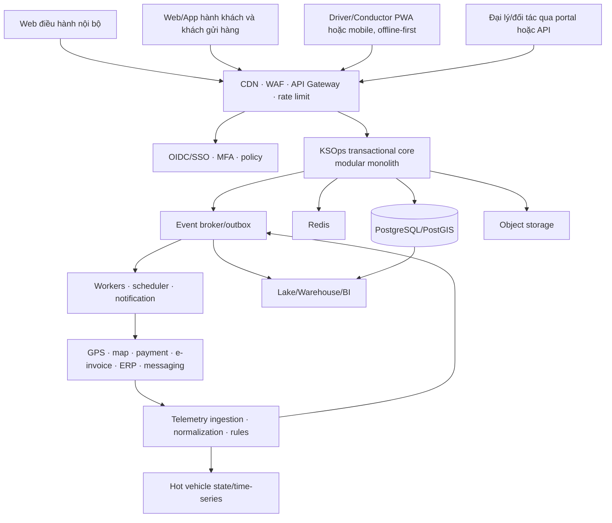

# KSOps Enterprise Blueprint

## 1. Mục đích và trạng thái

Tài liệu này mô tả **kiến trúc và lộ trình mục tiêu 12–15 tháng** cho một hệ thống điều hành vận tải do doanh nghiệp sở hữu. Đây không phải mô tả hệ thống nội bộ hiện hữu của Kumho Samco và cũng không khẳng định bản demo đã sẵn sàng vận hành thật.

| Lớp | Hiện trạng repository | Mục tiêu doanh nghiệp |
|---|---|---|
| Sản phẩm | frontend demo Next.js, 11 màn hình | nền tảng vận hành đa kênh cho hành khách, hàng hóa và thuê xe |
| Dữ liệu | fixture synthetic và `localStorage` | PostgreSQL/PostGIS, event/outbox, object storage và nền phân tích |
| Danh tính | chưa có đăng nhập/phân quyền thật | OIDC/SSO, MFA, RBAC + phạm vi chi nhánh và maker–checker |
| Tích hợp | chưa kết nối hệ thống thật | adapter GPS, thanh toán, hóa đơn, kế toán, bản đồ và thông báo |
| Vận hành | Vercel preview, không có SLA | môi trường tách biệt, SLO, quan sát, backup/restore và trực hỗ trợ |
| Tuân thủ | dữ liệu demo, không có PII thật | privacy-by-design, audit, retention và phê duyệt pháp lý |

Kế hoạch [12 tuần](DEVELOPMENT_PLAN.md) là một lát cắt pilot có kiểm soát trong blueprint này, không phải toàn bộ chương trình chuyển đổi.

## 2. Tầm nhìn và nguyên tắc

KSOps mục tiêu là một **Transportation Operating System**: gom nhu cầu dịch vụ, năng lực xe/tài xế, lịch khai thác, sự kiện thực thi và quyết toán vào một nguồn dữ liệu có kiểm soát. Website giới thiệu, ứng dụng khách hàng, ứng dụng tài xế và web điều hành là các kênh khác nhau của cùng nền tảng, không phải một màn hình dùng chung cho mọi đối tượng.

Các sản phẩm chuyên nghiệp cho thấy chuỗi giá trị không dừng ở quản lý phương tiện. SAP Transportation Management bao phủ dữ liệu chủ, lập kế hoạch, freight order, thực thi, tính cước và quyết toán; Oracle Transportation Management tách nhu cầu/order release khỏi shipment dùng để lập kế hoạch và theo dõi. Samsara tách web dashboard của điều phối/quản lý khỏi ứng dụng tài xế, đồng thời phân quyền theo chức năng và phạm vi đội xe. Các nguồn chính thức được liệt kê ở cuối tài liệu.

Nguyên tắc kiến trúc:

1. **Trip là trung tâm thực thi, không phải màn hình.** Vé, kiện hàng và hợp đồng phát sinh nhu cầu năng lực; chuyến tiêu thụ xe, tài xế, ghế, khoang hàng và thời gian.
2. **Tách domain nhưng không microservice sớm.** Giao dịch lõi bắt đầu bằng modular monolith; telemetry, worker và analytics có thể tách theo đặc tính tải.
3. **Server là nguồn quyết định.** UI không được tin cậy để tính giá cuối, đổi trạng thái, kiểm tra quyền hay chống xung đột.
4. **Event và audit là dữ liệu nghiệp vụ.** Mốc dự kiến/thực tế, actor, nguồn, vị trí, lý do và phiên bản phải truy vết được.
5. **Tích hợp commodity thay vì tự viết lại.** Doanh nghiệp sở hữu domain, orchestration và dữ liệu; dùng nhà cung cấp cho payment, bản đồ, GPS, IdP, thông báo và hóa đơn.
6. **Privacy, safety và reliability là điều kiện phát hành**, không phải việc làm sau khi có tính năng.
7. **Triển khai theo tuyến/chi nhánh**, có shadow mode, đối soát và khả năng quay về quy trình đã phê duyệt.

## 3. Phạm vi kinh doanh

Website công khai của Kumho Samco thể hiện ba dòng dịch vụ liên quan trực tiếp: vận tải hành khách tuyến cố định, vận chuyển hàng hóa và thuê xe hợp đồng. Blueprint dùng thông tin công khai này để định hướng sản phẩm; quy trình, cơ cấu và dữ liệu nội bộ vẫn phải được discovery và người có thẩm quyền xác nhận.

### 3.1 Bản đồ năng lực

| Miền | Năng lực mục tiêu | Kết quả nghiệp vụ |
|---|---|---|
| Dữ liệu chủ | công ty, vùng, chi nhánh, bến, văn phòng, tuyến, điểm dừng, biểu đồ chạy xe, loại xe, bảng giá | một định nghĩa thống nhất, có phiên bản và thời điểm hiệu lực |
| Hành khách | tìm chuyến, giữ ghế TTL, booking, vé QR, thanh toán, đổi/hủy/hoàn, check-in, manifest | không bán trùng ghế, doanh thu và hành khách truy vết theo chuyến |
| Hàng hóa | báo giá, cân/đo, kiện hàng, nhãn/scan, ghép chuyến, trung chuyển, COD, POD, claim | theo dõi từ tiếp nhận đến giao/đối soát, quản lý tải và bằng chứng |
| Thuê xe | lead, yêu cầu, báo giá nhiều phiên bản, phê duyệt, đặt cọc, hợp đồng, lịch trình, nghiệm thu | kiểm tra năng lực trước cam kết và tính đủ chi phí phát sinh |
| Kế hoạch/điều phối | nhu cầu năng lực, bảng ca, assignment, capacity, manifest, exception, ETA | xe/tài xế phù hợp, không trùng lịch, xử lý bất thường có lý do |
| Đội xe | vòng đời xe, giấy tờ, trạng thái, GPS, nhiên liệu, thu phí, utilization | biết năng lực thật và tổng chi phí sở hữu |
| Tài xế | hồ sơ tối thiểu, qualification, ca, thời gian làm việc, đào tạo, workflow mobile | phân công đúng năng lực, bằng chứng trước/sau chuyến |
| Bảo dưỡng | lịch theo ngày/km/giờ máy, inspection, defect, work order, parts, QC | xe không an toàn bị khóa và chỉ được release có thẩm quyền |
| CRM/CSKH | hồ sơ, consent/purpose, tương tác, khiếu nại, claim, SLA | lịch sử dịch vụ hợp nhất nhưng PII được giới hạn |
| Tài chính | rating, phụ phí, invoice, payment reference, refund, COD, settlement, công nợ | đối soát được tiền và chi phí theo đơn/chuyến/khách hàng |
| Dữ liệu/BI | operational read model, data warehouse, định nghĩa metric, export/schedule | một phiên bản sự thật cho điều hành và quản trị |
| Quản trị | IAM, quyền, scope, approval, audit, retention, cấu hình, integration admin | thay đổi nhạy cảm có kiểm soát và có thể điều tra |

### 3.2 Vòng đời chính

```text
Vé:       available → held → booked → ticketed → checked-in → boarded
                         └→ expired/cancelled/refunded

Hàng hóa: draft → quoted → accepted → received → loaded → in-transit
                                                     → arrived → delivered → reconciled
                                                     └→ exception/claim

Hợp đồng: lead → request → quote-revision → approved → deposit → scheduled
                                                        → executing → accepted → invoiced → paid

Bảo dưỡng: reported/due → triaged → vehicle-blocked → work-order → quality-check → released
```

Transition do server kiểm soát. Sửa sai bằng correction event hoặc revision, không ghi đè lịch sử đã có hiệu lực.

## 4. Operating model

### 4.1 Quyền sở hữu

| Trách nhiệm | Owner đề xuất |
|---|---|
| Executive sponsor và ngân sách | Ban điều hành/COO |
| Business Product Owner | Trưởng đơn vị Điều hành/Khai thác vận tải |
| Product backlog và outcome | Product Owner cùng Product Manager/BA |
| Nền tảng kỹ thuật | IT/Chuyển đổi số |
| Dữ liệu xe/chuyến | Điều hành/Khai thác |
| Vé và chính sách hành khách | Kinh doanh vận tải hành khách/Phòng vé |
| Hàng hóa và COD | Khai thác hàng hóa |
| Hợp đồng/CRM | Kinh doanh và CSKH |
| Bảo dưỡng/safety | Kỹ thuật |
| Giá, invoice, settlement | Tài chính/Kế toán |
| Privacy/security | Data Owner, Legal/Compliance và Security |
| SLO, backup, incident | Platform/SRE cùng service owner |

Phòng Điều hành/Khai thác là chủ nghiệp vụ chính; điều phối viên vận hành hằng ngày. IT không tự quyết định quy tắc vận tải, còn phòng nghiệp vụ không tự cấp quyền hoặc thay đổi hạ tầng production.

### 4.2 Cơ chế quản trị

- Steering Committee hàng tháng: sponsor, vận hành, IT, tài chính, kỹ thuật, data/privacy.
- Product Council hai tuần/lần: ưu tiên outcome, scope và phụ thuộc liên phòng.
- Change Advisory theo rủi ro: migration, bảng giá, quyền, tích hợp và thay đổi ảnh hưởng safety.
- Data Council hàng tháng: owner, glossary, chất lượng, retention, quyền sử dụng và export.
- Incident review không đổ lỗi: nguyên nhân hệ thống, action, owner, deadline và kiểm chứng.
- Access review tối thiểu hàng quý; quyền đặc quyền và service account thường xuyên hơn theo policy.

Ma trận role/permission chi tiết nằm tại [RBAC_MATRIX.md](RBAC_MATRIX.md).

## 5. Kiến trúc đa kênh mục tiêu



### 5.1 Ranh giới triển khai

- **Transactional core:** identity mapping, passenger, cargo, contract, planning/dispatch, fleet, driver, maintenance, CRM, billing và audit trong một deployable nhưng tách module/domain.
- **Telemetry ingestion:** process riêng vì chịu burst, at-least-once, thiết bị offline và dữ liệu tần suất cao.
- **Workers:** notification, reconciliation, report/export, document scan và integration retry không giữ transaction web.
- **Read models/analytics:** dashboard điều hành dùng projection; báo cáo lịch sử dùng warehouse, không ép OLTP xử lý scan lớn.
- Chỉ tách module thành service khi có bằng chứng về scale, availability, security boundary hoặc ownership độc lập; bắt buộc có contract version, idempotency, trace và migration plan.

### 5.2 Lưu trữ

| Store | Mục đích | Không dùng cho |
|---|---|---|
| PostgreSQL/PostGIS | nguồn sự thật giao dịch, constraint, lịch/tuyến/geospatial | telemetry raw khối lượng lớn |
| Redis | seat hold TTL, rate limit, cache ngắn, current coordination | ledger hoặc nguồn sự thật cuối |
| Event broker | async work, fan-out, telemetry/event, replay có kiểm soát | thay thế audit/business database |
| Object storage | POD, ảnh inspection, hợp đồng, export; quarantine và malware scan | public bucket chứa PII |
| Hot state/time-series | vị trí và signal gần thời gian thực | hồ sơ khách hàng |
| Lake/warehouse | lịch sử, BI, forecast, read model lớn | mutation nghiệp vụ trực tiếp |

AWS Connected Mobility khuyến nghị chuẩn hóa nhiều nguồn telemetry thành signal catalog chung trước khi xử lý trip, safety, maintenance và geofence. Microsoft Fleet reference architecture cũng tách MQTT/event ingestion, enrichment bằng metadata, lưu lịch sử, geospatial dashboard và alert. KSOps nên dùng lớp chuẩn hóa nhà cung cấp thay vì gắn domain trực tiếp với một loại thiết bị GPS.

## 6. Mô hình domain, entity và event

### 6.1 Entity cốt lõi

| Domain | Entity chính |
|---|---|
| Organization | `Organization`, `Region`, `Branch`, `Station`, `Office`, `UserRoleScope` |
| Network | `Route`, `Stop`, `ServiceCalendar`, `Schedule`, `Trip`, `TripStop` |
| Capacity | `VehicleType`, `Vehicle`, `SeatLayout`, `CargoCompartment`, `CapacityDemand`, `Assignment` |
| Workforce | `Driver`, `Qualification`, `Shift`, `Availability`, `DriverTask` |
| Passenger | `JourneySearch`, `SeatInventory`, `SeatHold`, `Booking`, `Ticket`, `CheckIn`, `Refund` |
| Cargo | `CargoOrder`, `Package`, `RateSnapshot`, `Label`, `Scan`, `ManifestItem`, `POD`, `COD`, `Claim` |
| Contract | `RentalRequest`, `QuotationRevision`, `Approval`, `Contract`, `ContractTrip`, `Acceptance` |
| Maintenance | `MaintenancePlan`, `Inspection`, `Defect`, `WorkOrder`, `PartUsage`, `ReleaseDecision` |
| Customer | `Customer`, `OrganizationAccount`, `ContactPoint`, `Consent`, `Interaction`, `Complaint` |
| Finance | `Tariff`, `Charge`, `Invoice`, `PaymentReference`, `Refund`, `Settlement`, `Reconciliation` |
| Platform | `IntegrationEndpoint`, `WebhookDelivery`, `Notification`, `AuditEvent`, `DataExport` |

Mỗi entity có ID server-side, public code không chứa PII, timestamp UTC, `version` cho optimistic concurrency và data owner. Tiền dùng integer minor unit + currency; giá, thuế và policy được snapshot tại thời điểm xác nhận.

### 6.2 Event contract

| Event mẫu | Publisher | Consumer | Yêu cầu |
|---|---|---|---|
| `booking.seat-held` | Passenger | expiry worker/read model | TTL, principal, trip/seat; không có PII rộng |
| `booking.confirmed` | Passenger | ticket, invoice, notification | idempotency key và price snapshot reference |
| `cargo.received` | Cargo | manifest, notification, BI | package/office, occurred/received time |
| `cargo.loaded` | Dispatch/Cargo | capacity projection, tracking | trip, scan source, actor/device |
| `trip.assignment-changed` | Dispatch | driver app, audit, notification | old/new assignment, reason, version |
| `trip.departed/arrived` | Execution | ETA, customer tracking, settlement | expected/actual time, location, source |
| `vehicle.blocked/released` | Maintenance | Dispatch/Fleet | reason, policy, approver; hard safety gate |
| `payment.status-changed` | Billing adapter | booking/invoice/reconciliation | provider event ID, signature result, amount match |
| `telemetry.vehicle-state` | Telemetry | map, alert, hot store | source, freshness, quality, event key |
| `audit.security-event` | Platform | security store/alert | append-only, redact, integrity protection |

Outbox đảm bảo entity và event cùng commit. Consumer chịu at-least-once, phải idempotent; retry có exponential backoff + jitter, DLQ, replay theo quyền và audit.

## 7. Tích hợp

### 7.1 Danh mục tích hợp

| Tích hợp | Chiến lược | Kiểm soát bắt buộc |
|---|---|---|
| GPS/telematics | dùng provider/thiết bị hiện có qua adapter; chuẩn hóa signal | device/provider identity, freshness, sanity check, dedup, fallback |
| Bản đồ/traffic/geocoding | dùng dịch vụ chuyên dụng | quota, cache policy, attribution, cost cap, fallback |
| Payment | hosted checkout/tokenization | signed callback, replay protection, amount/currency match, reconciliation |
| E-invoice/chữ ký số | adapter nhà cung cấp được phê duyệt | schema/version, retry, trạng thái pháp lý, đối soát |
| ERP/kế toán | posting/reference hai chiều | idempotency, mapping ledger, batch close, mismatch queue |
| SMS/email/Zalo/push | notification adapter | template approval, consent/purpose, redact, delivery status |
| Đại lý/đối tác | portal/API versioned | OAuth scope, rate limit, idempotency, contract test |
| Kho/toll/fuel | adapter theo giai đoạn | data owner, reconciliation, quality/freshness |

### 7.2 Chuẩn hợp đồng

- REST/OpenAPI versioned cho request/response; cursor pagination và error envelope ổn định.
- Webhook dùng HTTPS, HMAC/signature, timestamp tolerance, event ID và replay protection. Tài liệu Samsara mô tả chính cơ chế chữ ký HMAC cho webhook.
- `Idempotency-Key` cho create booking/order, payment/refund và action có retry.
- Mỗi adapter có timeout, circuit breaker, retry budget, DLQ, sandbox, owner, SLO và runbook.
- Không gọi dịch vụ ngoài khi giữ DB transaction.
- Contract test và reconciliation là release gate; không chỉ test “HTTP 200”.

## 8. Bảo mật, quyền riêng tư và an toàn

Baseline quản trị theo NIST CSF 2.0: Govern, Identify, Protect, Detect, Respond và Recover. Web/API dùng OWASP ASVS làm tiêu chí verification. Zero Trust nghĩa là không cấp niềm tin chỉ vì thiết bị đang trong mạng nội bộ; user, device và resource đều phải được xác thực/ủy quyền phù hợp.

Kiểm soát tối thiểu:

- OIDC Authorization Code + PKCE, MFA cho quyền đặc quyền, session revoke và re-authentication cho action nhạy cảm.
- RBAC + scope vùng/chi nhánh/tuyến/đội xe; ABAC cho assigned trip/shift/ownership; deny-by-default.
- Maker–checker cho refund lớn, thay bảng giá, settlement, bulk export và cấp quyền.
- TLS, KMS, encryption at rest/backup, secret manager, workload identity và rotation.
- Append-only audit cho đăng nhập/deny, PII reveal/export, quyền, giá, payment/refund, assignment/override, maintenance release và integration admin.
- Không ghi token, full contact, raw GPS, payment payload, giấy tờ hay attachment vào logs/traces.
- Hosted/tokenized payment; KSOps không lưu PAN/CVV. Nếu hệ thống lưu, xử lý, truyền hoặc có thể tác động tới cardholder data environment thì phạm vi PCI DSS phải được đánh giá chính thức.
- Device/provider telemetry dùng identity/certificate/token riêng, rotation/revoke, allowlist command và không điều khiển xe trực tiếp từ dashboard pilot.
- Secure SDLC: threat modeling, SAST, dependency/secret/container/IaC scan, SBOM, DAST, penetration test, branch protection và artifact provenance.

Luật Bảo vệ dữ liệu cá nhân 2025 có hiệu lực từ 01/01/2026. Trước pilot cần data inventory, mục đích/cơ sở xử lý được phê duyệt, privacy notice, minimization, masking, retention/deletion, quy trình quyền của chủ thể dữ liệu, xử lý vi phạm và đánh giá luồng xuyên biên giới. Tài liệu này không thay thế tư vấn pháp lý; Legal/Data Owner phải duyệt từng luồng PII, GPS, hồ sơ tài xế, POD và export.

## 9. SRE, SLO và phục hồi

OpenTelemetry được dùng để phát sinh và liên kết metrics, logs và traces mà không khóa vào một backend. Quan sát kỹ thuật phải nối với kết quả nghiệp vụ: booking thành công, ghế không trùng, đơn được scan, tài xế nhận lệnh, GPS đủ mới và settlement cân bằng.

### 9.1 SLO theo độ trưởng thành

| Chỉ số | Pilot giới hạn | Mục tiêu v1 sau đo baseline |
|---|---:|---:|
| API nghiệp vụ lõi | 99,5%/tháng | 99,9%/tháng |
| Tìm chuyến/booking/payment | 99,5% trong cửa sổ pilot | 99,95% trong giờ bán đã xác định |
| API đọc p95 | < 500 ms | < 400–500 ms theo endpoint budget |
| API ghi p95 | < 800 ms | < 600–800 ms theo endpoint budget |
| GPS freshness | chỉ đo với adapter mock/sandbox | ≥95% vehicle state mới hơn 60 giây khi thiết bị có mạng |
| RPO/RTO | RPO 24h, RTO 4h nếu pilot chưa có giao dịch tài chính thật | giao dịch lõi RPO ≤5 phút, RTO ≤60 phút |
| Double booking/mất giao dịch xác nhận | 0 | 0 |

SLO cuối cùng phải được Product, Engineering và SRE cùng phê duyệt sau baseline. Error budget là `1 - SLO`; khi cạn budget, policy có thể dừng release ngoài security/P0 và ưu tiên reliability. Không đặt mục tiêu 100% thiếu thực tế.

### 9.2 Vận hành

- Golden signals: traffic, latency, errors, saturation; thêm DB pool, queue lag, webhook failure và cache/lock contention.
- Business signals: seat conflict, assignment conflict, order backlog, scan gap, payment mismatch, GPS stale, audit failure và export volume.
- Synthetic probes cho tìm chuyến → giữ ghế, tạo đơn → manifest và login → quyền.
- Alert chỉ phát khi có owner, severity, action và runbook; tránh alert không thể hành động.
- Backup PITR, multi-zone theo ADR, restore vào môi trường cô lập, checksum và business invariant.
- Diễn tập timeout provider, queue backlog, DB failover, GPS stale, callback lặp và data corruption.
- Blameless postmortem cho sự cố đáng kể; action có owner/deadline và theo dõi hoàn tất.

## 10. Chiến lược QA

| Lớp | Bằng chứng |
|---|---|
| Static/secure supply chain | type, lint, secret/data detector, dependency/IaC/container scan, SBOM |
| Unit/domain | pricing, rounding, transition, overlap, capacity, seat TTL, masking |
| Integration | DB constraint, transaction, outbox, repository, RBAC policy, audit immutability |
| Contract | payment, GPS, ERP, e-invoice, notification và partner API |
| E2E | critical journey theo từng role, scope và exception path |
| Concurrency | nhiều client tranh một ghế, gán cùng xe/tài xế, callback/retry lặp |
| Non-functional | load/spike/soak, offline sync, accessibility WCAG 2.2 AA, security, resilience, restore |
| UAT | người dùng phòng vé, hàng hóa, điều phối, kỹ thuật, tài chính; evidence và sign-off |

Release bị chặn khi còn Sev-1/2, security critical/high, thiếu negative authorization test, double-booking/conflict >0, reconciliation lệch, migration/restore chưa diễn tập hoặc audit không ghi được.

Chi tiết test case và lịch chạy nằm tại [TEST_PLAN.md](TEST_PLAN.md).

## 11. Đội ngũ và RACI chương trình

### 11.1 Quy mô đề xuất

Core team 12–15 người cho giai đoạn build/pilot:

- 1 Product Owner nghiệp vụ;
- 1 Product Manager/BA;
- 1 UX/Product Designer;
- 1 Tech Lead/Architect;
- 3–4 backend engineers;
- 2 frontend engineers;
- 1–2 mobile/PWA engineers;
- 2 QA/automation engineers;
- 1 Platform/SRE engineer;
- Security, Data/BI, Legal/Privacy và SME phòng ban tham gia bán thời gian hoặc shared service.

Không nên tính nhân sự chỉ theo lập trình. Data migration, đào tạo, change management, support, security và UAT tiêu tốn effort độc lập.

### 11.2 RACI cấp chương trình

Ký hiệu: `A` chịu trách nhiệm cuối, `R` thực hiện, `C` được tham vấn, `I` được thông báo.

| Deliverable | Sponsor | Product/Ops | IT/Tech | QA/SRE | Security/Data/Legal | Finance/Kỹ thuật/SME |
|---|---|---|---|---|---|---|
| Business case và scope | A | R | C | I | C | C |
| Domain/process/KPI | I | A/R | C | C | C | R/C |
| Kiến trúc và ADR | I | C | A/R | C | C | I |
| RBAC/data classification | I | C | R | C | A/R | C |
| Build và migration | I | C | A/R | R | C | I |
| Security/privacy gate | I | C | R | C | A | I |
| UAT | I | A/R | C | R | C | R |
| Go/no-go | A | R | R | R | R | C |
| Incident/SLO | I | A cho impact | R | A/R kỹ thuật | C | I |

## 12. Ước lượng effort

Effort là person-week gồm discovery, design, build, test, migration, documentation và release. Đây là range ra quyết định, sai số ban đầu có thể ±30%; không phải cam kết báo giá.

| Band | Effort | Ví dụ |
|---|---:|---|
| XS | 1–2 person-weeks | một report/adapter đơn giản đã có chuẩn |
| S | 3–6 | capability nhỏ, ít dependency |
| M | 7–12 | workflow/module vừa có data và test |
| L | 13–24 | domain nhiều role/transition/tích hợp |
| XL | 25–50+ | capability lõi xuyên hệ thống hoặc có migration |

| Workstream | Band sơ bộ | Ghi chú |
|---|---:|---|
| Platform foundation/IAM/audit | XL, 30–50 | xuyên suốt, không chỉ màn login |
| Fleet/driver/master data | XL, 30–50 | migration và qualification làm tăng biến động |
| Planning/dispatch/execution | XL, 45–75 | constraint, concurrency, exception, driver sync |
| Passenger inventory/booking | XL, 50–80 | seat consistency, payment/refund, channel |
| Cargo end-to-end | XL, 45–75 | scan, manifest, COD, POD, claim |
| Contract rental/CRM | L–XL, 25–45 | approval, recurring service, customer data |
| Maintenance/fuel/parts | L–XL, 30–50 | safety gate, inventory/vendor integration |
| Billing/settlement/accounting | XL, 40–70 | reconciliation và financial controls |
| Telemetry/data platform/BI | XL, 50–90 | provider variability, retention, metric contracts |
| Reliability/security/QA/change | XL, 60–100 | cross-cutting trong mọi workstream |

Các range có thể chạy song song; tổng calendar 12–15 tháng giả định core team ổn định, SME sẵn sàng và không thay toàn bộ ERP/bán vé theo kiểu big-bang.

## 13. Roadmap 12–15 tháng

| Giai đoạn | Thời gian | Phạm vi | Gate ra |
|---|---:|---|---|
| 0. Discovery và baseline | tháng 0–1,5 | process/service blueprint, data/integration inventory, KPI baseline, legal/privacy, pilot route/branch, target ADR | G0: sponsor chấp thuận problem/scope/data owner |
| 1. Foundation | tháng 1,5–3 | IAM/RBAC/scope, master data, audit, CI/CD, observability, DB/outbox, environment | G1: deny-by-default, restore thử, quality gate xanh |
| 2. Operations pilot | tháng 3–6 | fleet/driver, cargo order, dispatch/trip, event timeline, driver PWA, maintenance lock, reporting tối thiểu | G2: critical journey và UAT pilot đạt; shadow mode sẵn sàng |
| 3. Passenger và cargo production | tháng 6–9 | seat inventory, booking/payment/refund/QR, barcode/POD/COD, notification, reconciliation | G3: concurrency/payment/security/load gate đạt |
| 4. Contract, maintenance, finance | tháng 9–12 | quote/approval/recurring contract, work order/parts/fuel, invoice/e-invoice/ERP | G4: close/reconciliation, maker–checker và audit đạt |
| 5. Telematics, BI và rollout | tháng 12–15 | GPS normalization, ETA/geofence, warehouse/BI, SLO hardening, rollout chi nhánh | G5: SLO/DR/adoption/data-quality đủ scale |
| 6. Tối ưu liên tục | sau tháng 15 | route optimizer, demand forecast, predictive maintenance, anomaly detection | chỉ mở khi dữ liệu sạch và human approval/kill switch rõ |

Kế hoạch 12 tuần hiện tại trải qua discovery, foundation và một phần Operations pilot. Sau tuần 12, chương trình chỉ tiếp tục khi G2 hoặc waiver có owner/expiry được duyệt.

## 14. Migration và rollout

1. Lập inventory nguồn dữ liệu, owner, chất lượng, license, retention và trường nhạy cảm.
2. Tạo canonical ID, mapping chi nhánh/tuyến/xe/tài xế/khách hàng; deduplicate và record exception.
3. Chạy import lặp trong staging; đối soát count, checksum, tiền, capacity và business invariant.
4. Chọn một tuyến/nhóm chi nhánh và 10–20 xe làm pilot sau khi có baseline; không chọn chỉ vì thuận tiện kỹ thuật.
5. Đào tạo super-user; dùng synthetic rehearsal trước dữ liệu tối thiểu đã phê duyệt.
6. Shadow mode 2–4 tuần: KSOps ghi nhận nhưng quy trình chuẩn hiện hữu vẫn là nguồn quyết định cho tới go-live.
7. Cutover theo capability/chi nhánh, có freeze window, delta sync, smoke, reconciliation và rollback owner.
8. Hypercare theo giờ khai thác đã thống nhất; daily close, defect triage và adoption telemetry.
9. Chỉ rollout tiếp khi gate dữ liệu, nghiệp vụ, SLO, support và privacy đạt.

Không dùng dual-write kéo dài không kiểm soát. Mọi temporary bridge phải có owner, đối soát, ngày dừng và kế hoạch loại bỏ.

## 15. KPI và metric contract

Business KPI phải có công thức, nguồn, owner, độ mới và phạm vi; lấy baseline 4–8 tuần trước khi chốt target. Không dùng số commit/dòng code làm KPI.

| KPI | Công thức/ý nghĩa | Owner | Nhịp |
|---|---|---|---|
| On-time departure/arrival | chuyến trong tolerance / chuyến đủ điều kiện | Điều hành | ngày/tuần |
| Load factor hành khách | seat-km bán / seat-km cung ứng | Hành khách/BI | ngày/tháng |
| Seat inventory accuracy | inventory hệ thống khớp manifest/thực tế | Phòng vé + QA/Data | ngày |
| Cargo on-time delivery | đơn delivered trong SLA / đơn đủ điều kiện | Hàng hóa | ngày/tuần |
| Scan compliance | milestone có scan hợp lệ / milestone bắt buộc | Hàng hóa | ca/ngày |
| Claim/loss/damage rate | claim hợp lệ / đơn giao | Hàng hóa/CSKH | tuần/tháng |
| Dispatch lead time | thời gian ready → assignment hợp lệ | Điều hành | ca/ngày |
| Conflict rate | assignment bị từ chối/điều chỉnh do conflict | Điều hành | ngày |
| Vehicle utilization | giờ/km có dịch vụ / năng lực khả dụng | Fleet | tuần/tháng |
| Maintenance compliance | việc phòng ngừa đúng hạn / việc đến hạn | Kỹ thuật | tuần |
| Fleet availability | thời gian available / thời gian kế hoạch | Kỹ thuật/Điều hành | ngày |
| Fuel/idle | lít/100 km và idle time / engine-on time | Fleet | tuần |
| Contribution per trip | doanh thu thuần – chi phí phân bổ | Finance | chuyến/tháng |
| Reconciliation variance | chênh lệch KSOps/provider/ERP | Finance | ngày |
| Complaint resolution SLA | case đóng trong SLA / case đủ điều kiện | CSKH | tuần |
| Reliability | success ratio, latency, freshness, MTTR, change failure | SRE/Service owner | liên tục/tháng |

Target pilot nên ưu tiên invariant tuyệt đối (`double booking = 0`, giao dịch xác nhận không mất) và improvement so với baseline, thay vì sao chép “chuẩn ngành” không cùng định nghĩa.

## 16. Buy vs build

| Năng lực | Quyết định mặc định | Lý do |
|---|---|---|
| Domain vé/hàng/hợp đồng/dispatch | Build | tạo khác biệt, gắn quy trình và dữ liệu riêng |
| Capacity model và event timeline | Build | lõi hợp nhất ba dòng dịch vụ |
| Data model, integration facade, BI nghiệp vụ | Build | giữ quyền kiểm soát và khả năng thay provider |
| GPS hardware/telematics feed | Buy/integrate | chứng nhận, kết nối thiết bị và vận hành chuyên biệt |
| Map/geocode/traffic | Buy | dữ liệu mạng đường, cập nhật và quy mô |
| Payment | Buy/integrate | PCI, fraud, settlement và pháp lý chuyên ngành |
| IdP/SSO/MFA | Buy/managed | tránh tự xây authentication; vẫn tự quản policy/scope |
| SMS/email/Zalo/push | Buy/integrate | deliverability và quản lý kênh |
| E-invoice/chữ ký số | Buy/integrate | yêu cầu pháp lý và kết nối nhà cung cấp |
| ERP/kế toán | Integrate | tránh tái xây hệ thống sổ cái |
| Database/object/WAF/backup | Managed khi phù hợp | giảm toil; data-residency và exit plan phải được duyệt |
| Route optimization | Buy/solver trước, build orchestration | chỉ tự phát triển sâu khi có dữ liệu và lợi thế rõ |

Mọi quyết định mua cần đánh giá TCO 5 năm, SLA, security/privacy, data export, rate/quota, portability, exit cost, sandbox, support và khả năng thay provider qua adapter.

## 17. Rủi ro và gates

| Rủi ro | Giảm thiểu | Trigger/owner |
|---|---|---|
| Scope thay toàn bộ hệ thống cùng lúc | capability map, Must/Should, gate và change control | spillover >20% / Product Owner |
| Dữ liệu nội bộ/PII lọt repo hoặc preview | synthetic-only, DLP/secret scan, environment/data policy | detector/access alert / Security-Data |
| Bán trùng ghế/over-capacity | atomic hold, DB constraint, transaction, concurrency test | conflict >0 / Tech Lead |
| Gán trùng hoặc dùng xe không an toàn | overlap/safety constraint, maintenance lock, audit | invalid assignment >0 / Ops + Kỹ thuật |
| Giá/payment/COD/ERP lệch | immutable snapshot, idempotency, reconciliation, maker–checker | variance khác 0 ngoài tolerance / Finance |
| GPS sai, cũ hoặc provider mất kết nối | normalization, freshness/quality, circuit breaker, fallback | stale/error budget / Fleet Ops |
| Người dùng quay lại spreadsheet ngoài kiểm soát | co-design, super-user, training, adoption KPI, support | adoption dưới target / Product/Ops |
| Migration gây mất/double data | rehearsal, checksum/invariant, delta plan, backup/restore | reconciliation fail / Data + Tech Lead |
| Vendor lock-in/chi phí tăng | adapter, OTel, export test, quota/cost alert, exit clause | forecast vượt budget / IT Procurement |
| Pháp lý/retention chưa rõ | legal/data review trước field/integration, risk register | thiếu owner/legal basis / Legal-Data |
| SLO không đạt do release dồn dập | error budget, canary, feature flag, freeze policy | burn-rate alert / SRE + Product |

### Gate bắt buộc

- **G0 — Discovery:** problem, scope, owner, baseline, data map và legal/privacy question rõ.
- **G1 — Foundation:** IAM/RBAC deny tests, audit, environment, CI/CD, restore evidence.
- **G2 — Pilot:** critical journey, concurrency, UAT, training, support, rollback và shadow reconciliation đạt.
- **G3 — Transactional production:** payment/refund/COD, security/load, DR và customer-channel evidence đạt.
- **G4 — Financial/maintenance:** maker–checker, ledger reconciliation, e-invoice/ERP và safety release đạt.
- **G5 — Scale:** SLO/error budget, telemetry quality, data warehouse, cost/adoption và multi-branch support đạt.

Không được “go” bằng cách bỏ qua invariant safety, authorization, audit, data provenance, reconciliation hoặc khả năng restore. Waiver chỉ áp dụng cho rủi ro không thuộc nhóm cứng, có risk owner, compensating control và ngày hết hạn.

## 18. Tài liệu liên quan

- [Kế hoạch pilot 12 tuần](DEVELOPMENT_PLAN.md)
- [Ma trận phân quyền](RBAC_MATRIX.md)
- [Kiến trúc chi tiết](ARCHITECTURE.md)
- [Bảo mật và threat model](SECURITY.md)
- [Hợp đồng API mục tiêu](API_SPEC.md)
- [Chiến lược kiểm thử](TEST_PLAN.md)

## 19. Nguồn tham chiếu chính thức

### Nghiệp vụ vận tải và fleet

- [SAP Transportation Management — phạm vi sản phẩm](https://help.sap.com/docs/SAP_S4HANA_CLOUD/61e246f4b34c4e1790d8b7651c0b40a8/1d09ef79fcdd48569f8830f082e26713.html)
- [SAP Transportation Cockpit — ghép nhu cầu và năng lực](https://help.sap.com/docs/SAP_S4HANA_CLOUD/61e246f4b34c4e1790d8b7651c0b40a8/54deed6bbd8047e28dfa219370b7832c.html)
- [SAP Event Profiles — mốc thực thi vận tải](https://help.sap.com/docs/SAP_S4HANA_ON-PREMISE/e3dc5400c1cc41d1bc0ae0e7fd9aa5a2/7e7dc049211b489f9b21d0e7920cb8d9.html)
- [SAP Settlement](https://help.sap.com/docs/SAP_TRANSPORTATION_MANAGEMENT/54cf405c9d9e4c96bf091967ea29d6a7/4de4e09deeef447b8015f44d63971294.html)
- [Oracle OTM Order Management](https://docs.oracle.com/en/cloud/saas/transportation/26a/otmol/configuration/setting_up_otm/order_management.htm)
- [Oracle OTM Shipment Execution, tendering và tracking event](https://docs.oracle.com/en/cloud/saas/transportation/26a/otmol/configuration/setting_up_otm/shipment_execution.htm)
- [Samsara Dashboard modules](https://kb.samsara.com/hc/en-us/articles/4404415451149-Dashboard-Menus)
- [Samsara Driver App routes](https://kb.samsara.com/hc/en-us/articles/360041258291-View-Start-and-Complete-Routes)
- [Samsara roles và phạm vi tag](https://kb.samsara.com/hc/en-us/articles/4411870638733-Administrative-Roles)
- [Samsara DVIR và maintenance workflow](https://kb.samsara.com/hc/en-us/articles/40227269615629-DVIR-2-0-Beta)
- [Microsoft Fleet Management reference architecture](https://learn.microsoft.com/en-us/fabric/real-time-intelligence/architectures/fleet-management)
- [AWS Connected Mobility — source-agnostic telemetry](https://docs.aws.amazon.com/guidance/latest/connected-mobility-on-aws/solution-overview.html)
- [AWS Connected Vehicles — IoT, certificate và security architecture](https://aws.amazon.com/solutions/guidance/connected-vehicles-on-aws/)

### Bảo mật, privacy, payment và reliability

- [NIST Cybersecurity Framework 2.0](https://www.nist.gov/publications/nist-cybersecurity-framework-csf-20)
- [NIST SP 800-207 Zero Trust Architecture](https://csrc.nist.gov/pubs/sp/800/207/final)
- [OWASP Application Security Verification Standard](https://owasp.org/www-project-application-security-verification-standard/)
- [PCI DSS 4.0.1 Document Library](https://www.pcisecuritystandards.org/document_library/?class=pcidss&doc=pci_dss)
- [OpenTelemetry documentation](https://opentelemetry.io/docs/)
- [Google SRE — Implementing SLOs](https://sre.google/workbook/implementing-slos/)
- [Google SRE — Error Budget Policy](https://sre.google/workbook/error-budget-policy/)
- [Chính phủ Việt Nam — những quy định đáng chú ý của Luật Bảo vệ dữ liệu cá nhân 2025](https://xaydungchinhsach.chinhphu.vn/nhung-quy-dinh-dang-chu-y-trong-luat-bao-ve-du-lieu-ca-nhan-2025-119251225084154179.htm)

### Phạm vi công khai của doanh nghiệp

- [Kumho Samco Buslines](https://kumhosamco.com.vn/)
- [Quy trình dịch vụ vận chuyển hàng hóa công khai](https://kumhosamco.com.vn/dich-vu-gui-hang-phan-thiet-da-lat-ha-tien-bmt/)
