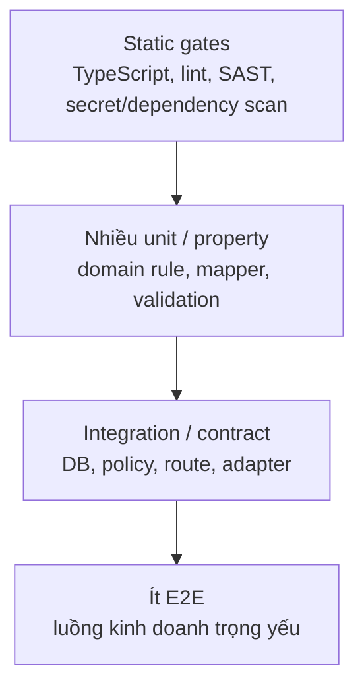

# Kế hoạch kiểm thử và UAT KSOps

## 1. Mục tiêu

Kế hoạch này chứng minh KSOps đáp ứng acceptance criteria, không vượt ranh giới quyền, bảo toàn dữ liệu và có thể vận hành/rollback ở phạm vi pilot. Kiểm thử dựa trên rủi ro: identity/RBAC, thay đổi CMDB, incident workflow, audit, import/export và attachment được ưu tiên hơn chi tiết trang trí.

Bản demo hiện tại có typecheck, lint, Next production build, kiểm tra cấu hình bảo mật/Vercel, quét toàn bộ source để chặn literal IPv4/MAC, kiểm tra shell/route và unit test cho các hàm thuần của danh mục tài sản (seed, filter, sort, phân trang, thống kê và CSV formula-injection guard). Các suite integration, component và E2E bên dưới vẫn là target cần triển khai theo roadmap, không phải tuyên bố rằng chúng đã tồn tại.

## 2. Phạm vi chất lượng

### Functional

- identity/session và RBAC theo action/object/scope;
- asset/type/relationship/history/import;
- incident/request, assignment, transition, comment, SLA;
- maintenance/checklist và knowledge workflow;
- service health freshness, dashboard/KPI;
- audit, export, job, attachment nếu được bật.

### Non-functional

- security/abuse, privacy và log redaction;
- accessibility WCAG 2.2 AA cho luồng chính;
- responsive và browser compatibility;
- performance, capacity, reliability và dependency failure;
- backup/restore, deploy/rollback, migration và observability.

### Không kiểm thử trên demo công khai

- IP/hostname/MAC/VLAN/topology thật;
- quét mạng, agent hoặc lệnh tác động hạ tầng;
- credential/tài khoản doanh nghiệp thật nếu chưa có môi trường và phê duyệt;
- production load test hoặc destructive security test.

## 3. Chiến lược test

- **Static:** lint, build/type, format policy, forbidden file/secret scan, dependency/SAST.
- **Unit:** state machine, SLA calculation, policy predicate, validation, mapping, redaction. Không mock domain rule đang test.
- **Integration:** route → policy → repository trên database thật tạm thời; transaction, constraint, migration, authorization.
- **Contract:** OpenAPI request/response; consumer/provider cho adapter; breaking-change detection.
- **Component/UI:** rendering, interaction, loading/empty/error/permission state, keyboard và axe.
- **E2E:** số lượng nhỏ, ổn định, kiểm tra happy path và failure/deny path quan trọng.
- **Exploratory:** session theo charter cho workflow phức tạp, error recovery, quyền và accessibility.

Ưu tiên test gần rule nhất. Không dùng E2E để kiểm tra mọi tổ hợp enum; tránh snapshot lớn không thể review.

## 4. Môi trường và dữ liệu kiểm thử

| Môi trường | Mục đích | Dataset | Reset |
|---|---|---|---|
| Local | unit/component/dev | factory synthetic deterministic | mỗi test/suite |
| CI | static/unit/integration/contract | database ephemeral + fixed seed | mỗi job |
| Preview | review UI/smoke | seed synthetic theo PR | mỗi deploy |
| Staging | E2E, security, performance, UAT | synthetic gần production về volume/distribution | lịch có kiểm soát |
| Production pilot | smoke/observability, không destructive | dữ liệu đã được phê duyệt | không auto reset |

Quy tắc test data:

- factory dùng seed cố định khi debug; ID/tên dạng `DEMO`, email dùng `example.invalid`;
- tuyệt đối không sao chép DOCX/PDF, database dump, ảnh, log hoặc export doanh nghiệp;
- fixture không chứa IP, hostname, MAC, VLAN hay credential thật;
- test chạy độc lập, không phụ thuộc thứ tự/thời gian hệ thống; inject clock/UUID khi cần;
- timezone cases bao gồm UTC và `Asia/Ho_Chi_Minh`, DST bằng timezone đại diện khác dù Việt Nam không DST;
- teardown xác minh không còn object/job tạm; artifact thất bại có retention ngắn và không chứa secret.

## 5. Ma trận truy vết yêu cầu

| Requirement | Risk | Test level | Test ID đại diện | Evidence |
|---|---|---|---|---|
| IAM/RBAC deny-by-default | rất cao | unit + integration + E2E | AUTH-001…012 | report + audit event |
| Asset lifecycle/concurrency | cao | unit + integration | AST-001…010 | DB assertion + API response |
| Relationship integrity | cao | property + integration | REL-001…006 | constraint/rule results |
| Incident transition | cao | state-machine + E2E | INC-001…015 | timeline + audit |
| SLA calculation | cao | unit/property | SLA-001…012 | expected clock table |
| Maintenance timezone/conflict | vừa | unit + E2E | MNT-001…008 | calendar assertions |
| Knowledge sanitize/publish | cao | security + E2E | KB-001…008 | sanitized DOM/revision |
| Dashboard accuracy/freshness | cao | query reconciliation | KPI-001…010 | fixture truth table |
| Import/export safety | cao | integration/security | IO-001…012 | dry-run/error/CSV checks |
| Audit completeness/redaction | rất cao | integration | AUD-001…010 | event schema + log scan |
| Accessibility | cao | automated + manual | A11Y-001…012 | axe + keyboard checklist |
| Backup/restore/rollback | rất cao | operational drill | OPS-001…006 | timestamped drill record |

Mỗi user story liên kết test ID trong acceptance criteria/PR. Test case bị bỏ phải có risk acceptance, owner và expiry; không chỉ ghi “không đủ thời gian”.

## 6. Bộ test chức năng trọng yếu

### Identity và RBAC

| ID | Kịch bản | Kết quả mong đợi |
|---|---|---|
| AUTH-001 | request không session vào route bảo vệ | 401/redirect an toàn, không lộ dữ liệu |
| AUTH-002 | token/session hết hạn, issuer/audience/nonce sai | từ chối; audit reason code; không stack |
| AUTH-003 | requester xem ticket của chính mình | cho phép đúng field public |
| AUTH-004 | requester đổi ID sang ticket người khác | 404/deny, không existence oracle |
| AUTH-005 | agent thao tác ngoài team scope | từ chối ở server và không ghi DB |
| AUTH-006 | asset operator gọi endpoint gán role | 403; audit access failure theo policy |
| AUTH-007 | security admin gán role có expiry | thành công, audit; policy/session invalidated |
| AUTH-008 | client thêm `role=admin`, `ownerId` vào payload | ignored/rejected, không mass assignment |
| AUTH-009 | CSRF thiếu/sai trên write dùng cookie | từ chối |
| AUTH-010 | logout/revoke/khóa user | session cũ mất hiệu lực |
| AUTH-011 | đổi role trong khi cache/dashboard mở | response sau đổi quyền không dùng cache cũ |
| AUTH-012 | break-glass | thời hạn ngắn, alert/audit và post-review evidence |

### CMDB

| ID | Kịch bản | Kết quả mong đợi |
|---|---|---|
| AST-001 | tạo asset hợp lệ | 201, mã duy nhất, history/audit/outbox cùng commit |
| AST-002 | thiếu required/dynamic attribute sai schema | 422 với field error an toàn |
| AST-003 | hai request tạo cùng unique display key | một thành công, một conflict; không duplicate |
| AST-004 | update bằng ETag cũ | 412, record không bị ghi đè |
| AST-005 | archive asset đang liên kết | rule/cảnh báo đúng; quan hệ không orphan |
| AST-006 | list kết hợp filter/sort/cursor | không trùng/mất record giữa page |
| REL-001 | self-reference/duplicate | bị chặn |
| REL-002 | cycle với loại quan hệ cấm | bị chặn, transaction rollback |
| REL-003 | target ngoài scope | không lộ target qua relationship |
| IO-001 | import dry-run | không ghi DB; counts/errors đúng |
| IO-002 | CSV quá lớn/field nguy hiểm/encoding lỗi | từ chối an toàn, không partial write ngoài contract |

### Incident/SLA

| ID | Kịch bản | Kết quả mong đợi |
|---|---|---|
| INC-001 | requester tạo ticket, retry cùng idempotency key | một incident; response được replay |
| INC-002 | cùng key nhưng body khác | 409, không tạo record thứ hai |
| INC-003 | transition hợp lệ `new → triaged → in_progress` | state, timeline, audit và version tăng |
| INC-004 | transition không hợp lệ/role không đủ | 409/403; state giữ nguyên |
| INC-005 | hai agent assign đồng thời | optimistic lock; không mất update |
| INC-006 | public/internal comment | requester không đọc được internal comment |
| INC-007 | comment chứa script/HTML độc hại | hiển thị escaped/sanitized, CSP không bị phá |
| SLA-001 | priority map policy | due time đúng version policy |
| SLA-002 | pending có/không pause theo reason | clock đúng rule, event đủ |
| SLA-003 | timezone/weekend/holiday/boundary | kết quả đúng truth table |
| SLA-004 | policy thay đổi | ticket cũ theo snapshot/version đã định, không tự biến đổi |

### Maintenance, knowledge, health và dashboard

| ID | Kịch bản | Kết quả mong đợi |
|---|---|---|
| MNT-001 | lịch start ≥ end | 422 |
| MNT-002 | lịch trùng asset/time | cảnh báo hoặc chặn theo policy, có lý do override |
| MNT-003 | hoàn tất thiếu checklist bắt buộc | transition bị chặn |
| KB-001 | author publish trực tiếp không có quyền | 403 |
| KB-002 | edit bản đã publish | tạo revision, bản công bố cũ immutable đến khi duyệt |
| KB-003 | nội dung XSS/link nguy hiểm | sanitize, không thực thi |
| KPI-001 | dashboard với fixture đã biết | mọi KPI khớp truth table |
| KPI-002 | health source stale/unavailable | `unknown/stale`, không giả dữ liệu mới |
| KPI-003 | scope filter bị sửa trên query | server áp effective scope, không lộ aggregate ngoài quyền |
| KPI-004 | empty/partial/error state | UI rõ ràng, không hiển thị 0 gây hiểu nhầm |

## 7. API/contract và database

- Validate tất cả example/request/response với OpenAPI 3.1.
- Test status, error code, `X-Request-ID`, ETag, Location, pagination và rate-limit header.
- Contract test bảo đảm DTO không vô tình xuất internal field khi ORM entity thêm cột.
- Migration test chạy từ snapshot version được hỗ trợ đến head trên DB sạch và DB có fixture.
- Constraint test cho unique, foreign key, check enum/date và cascade/restrict.
- Transaction fault injection tại từng bước entity/history/audit/outbox; hoặc tất cả commit, hoặc tất cả rollback.
- Query plan/limit test cho search, dashboard và audit; chống unbounded scan/Cartesian explosion.
- Migration destructive cần backup/restore evidence và chiến lược expand–migrate–contract.

## 8. Security testing

Security cases bám threat model trong `SECURITY.md`:

- SAST/SCA/secret scan trên mỗi PR; SBOM/release scan;
- IDOR và permission matrix positive/negative cho mọi endpoint;
- OIDC/session/CSRF/CORS/CSP/open redirect/cache poisoning;
- SQL/NoSQL/template/command injection tại mọi boundary liên quan;
- reflected/stored/DOM XSS, markdown/link sanitizer;
- SSRF corpus cho adapter/webhook; URL private/link-local/redirect chain;
- rate/body/page/file/decompression limit và abuse search/export;
- attachment filename/path/MIME mismatch/quarantine/scan/download auth;
- CSV formula injection và export authorization/expiry;
- log/error/audit redaction bằng canary secret giả;
- dependency failure, retry storm và queue replay idempotency.

DAST chỉ chạy trên staging synthetic và theo rules of engagement. Không pentest website/hạ tầng doanh nghiệp hoặc bên thứ ba nếu chưa có văn bản cho phép.

## 9. Accessibility và UX

Target WCAG 2.2 AA cho dashboard và luồng chính.

- semantic landmark/heading/table/form; label và error association;
- toàn bộ chức năng dùng keyboard; focus visible, thứ tự logic, focus return sau modal;
- skip link, live region vừa đủ, không spam screen reader;
- contrast text/control/focus, không dùng màu làm tín hiệu duy nhất;
- zoom 200–400%, reflow ở 320 CSS px; touch target phù hợp;
- prefers-reduced-motion; animation không gây cản trở;
- loading skeleton có accessible status; error/empty/permission state dễ hiểu;
- locale Việt, định dạng ngày/giờ/số nhất quán; timezone được hiển thị khi ảnh hưởng;
- test screen reader thủ công ít nhất NVDA + Chrome/Firefox trên Windows cho luồng pilot.

axe/automated scan là quality gate nhưng không thay keyboard/screen-reader/manual review.

## 10. Compatibility và responsive

Browser matrix pilot: hai phiên bản stable gần nhất của Chrome, Edge, Firefox; Safari stable nếu có người dùng/thiết bị mục tiêu. Kích thước đại diện: 320/375/768/1024/1440 CSS px. Test desktop keyboard và mobile touch, portrait/landscape khi phù hợp.

Không dùng user-agent sniffing để sửa layout. Ghi rõ nếu platform/runtime không hỗ trợ browser cũ; không polyfill tùy tiện thiếu security maintenance.

## 11. Performance và resilience

### Workload synthetic ban đầu

Kịch bản/volume cuối cùng phải dựa discovery; baseline đề xuất cho staging:

- 50 người dùng đồng thời, ramp 10 phút, steady 30 phút;
- read/write 80/20, dashboard 20%, asset list 25%, incident list/detail 35%, create/update 15%, khác 5%;
- dataset 10.000 asset, 25.000 incident, 100.000 event/audit synthetic;
- performance budget: read API p95 <500 ms, write p95 <800 ms, error <1%, LCP p75 <2,5 s theo profile đã thống nhất.

Test soak 2–4 giờ khi đã ổn định; spike để xác định backpressure, không dùng làm cam kết capacity. Ghi client/server latency, DB pool/query, CPU/memory, queue depth, cache hit và error code.

### Fault injection

- DB timeout/connection exhaustion;
- IdP unavailable hoặc token introspection chậm;
- monitoring/notification adapter timeout/429/500;
- worker crash giữa retry, duplicate queue delivery;
- object scan chậm/thất bại;
- deploy/migration thất bại và rollback;
- stale cache/clock skew trong biên hỗ trợ.

Kết quả phải graceful: timeout hữu hạn, retry có jitter, no data corruption, metric/alert đúng, UI không giả dữ liệu khỏe.

## 12. CI/CD quality gates

### Pull request

- install từ lockfile trên Node version chuẩn;
- lint + build/type + unit/component/integration/contract;
- secret/forbidden-file/dependency/SAST checks;
- migration compatibility khi schema đổi;
- coverage diff/risk review, không dùng một con số coverage để thay chất lượng;
- preview smoke và accessibility scan cho thay đổi UI trọng yếu.

### Main/staging

- immutable artifact, migration dry-run/preflight;
- E2E regression, API contract, DAST baseline;
- performance smoke và telemetry assertion;
- release candidate notes, known limitation và rollback plan.

### Production pilot

- approval môi trường; promote cùng artifact digest;
- migration có lock/backup checkpoint;
- post-deploy smoke read/write bằng tài khoản test được phê duyệt;
- kiểm tra error/SLO/audit trong observation window;
- rollback/feature disable khi vượt threshold đã thống nhất.

## 13. UAT

### Người tham gia

- 1 đại diện requester;
- 1–2 service agent;
- 1 asset operator;
- 1 service manager/PO;
- QA điều phối; Security/Ops quan sát case liên quan.

Tài khoản UAT tách role, dữ liệu synthetic và scope rõ. Không dùng shared admin account.

### Kịch bản UAT

| UAT ID | Vai trò | Nhiệm vụ | Tiêu chí nghiệm thu |
|---|---|---|---|
| UAT-01 | Requester | tạo và theo dõi ticket | hoàn tất không hỗ trợ; chỉ thấy dữ liệu của mình |
| UAT-02 | Agent | triage, assign, comment, resolve | workflow rõ; SLA/timeline đúng; internal note được bảo vệ |
| UAT-03 | Asset operator | tạo asset, quan hệ và lên lịch bảo trì | validation dễ hiểu; history có thể truy vết |
| UAT-04 | Service manager | xem KPI, SLA, duyệt KB | số liệu đối soát; freshness/definition rõ |
| UAT-05 | Security admin | cấp role có expiry rồi revoke | quyền có hiệu lực đúng; session/cache invalidated; audit đủ |
| UAT-06 | Auditor | truy vấn audit theo mandate | đọc được sự kiện cần thiết, không sửa và không thấy field cấm |
| UAT-07 | Mọi vai trò | keyboard/mobile/error recovery | hoàn thành task; không blocker accessibility |
| UAT-08 | Ops | deploy/rollback/restore drill | runbook khả thi, owner/metric/alert rõ |

Mỗi case ghi tester/role/build/environment, precondition, steps, expected/actual, evidence, defect link và sign-off. UAT không chỉ là “người dùng đã xem demo”.

### Exit UAT

- 100% Must flow được chạy; pass ≥95%, phần fail còn lại không thuộc Sev-1/2 và có workaround được PO chấp thuận;
- Sev-1/2 mở = 0; Sev-3 có owner, due date và release note;
- task completion ≥90% với sample UAT, không có accessibility blocker;
- PO, QA, Security/Data Owner và Ops ký go/no-go theo phạm vi trách nhiệm.

## 14. Quản lý defect

| Severity | Định nghĩa | Xử lý |
|---|---|---|
| Sev-1 Critical | lộ/huỷ dữ liệu, auth bypass diện rộng, hệ thống không dùng được, không workaround | dừng release, incident process ngay |
| Sev-2 High | luồng Must hỏng, sai quyền/số liệu quan trọng, workaround không chấp nhận | chặn release/pilot |
| Sev-3 Medium | chức năng phụ hỏng hoặc workaround hợp lý | triage, owner/deadline; có thể waiver |
| Sev-4 Low | cosmetic/cải tiến không ảnh hưởng task chính | backlog theo ưu tiên |

Defect gồm build/environment, reproducibility, precondition, steps, expected/actual, evidence đã redact, impact và suspected regression range. Priority do PO quyết định; severity do QA/Security/Ops dựa tác động, không hạ severity để kịp lịch.

## 15. Entry/exit và báo cáo

### Entry cho system test

- Must feature code complete, CI xanh, API/schema freeze có kiểm soát;
- staging ổn định, seed synthetic có version, account/role matrix sẵn;
- test case/risk/threat model được review; telemetry và reset procedure hoạt động.

### Exit trước pilot

- regression/contract/RBAC/security/accessibility/UAT đạt tiêu chí;
- Sev-1/2 bằng 0, không có critical/high security finding chưa xử lý;
- performance/SLO target đạt hoặc limitation được phê duyệt rõ;
- migration, backup/restore, deploy/rollback và alert/runbook đã diễn tập;
- test summary ghi scope, build digest, môi trường, pass/fail/blocked, residual risk và sign-off.

### Evidence

Lưu machine-readable report/JUnit, coverage, accessibility/security summary, migration/restore evidence và UAT sign-off theo retention của dự án. Screenshot/video phải dùng dữ liệu synthetic, crop metadata nhạy cảm và không đưa ảnh nội bộ vào repository. Một test run chỉ hợp lệ khi truy được commit SHA, artifact digest, config version và dataset seed.
